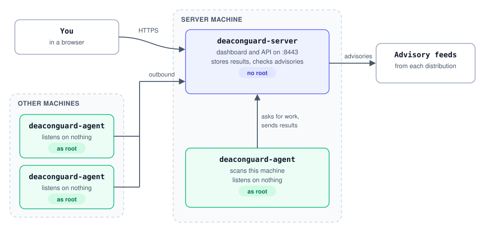

# DeaconGuard

[](https://github.com/Cloudopsshell/deaconguard/releases/latest)
[](https://github.com/Cloudopsshell/deaconguard/actions/workflows/ci.yml)
[](LICENSE)

**Find what's vulnerable, misconfigured or compromised.** Across your Linux servers, Kubernetes clusters and container images, from one dashboard you host.

DeaconGuard is a security scanner written in Go, for Linux servers, Kubernetes clusters and container images. On a Linux machine, it runs fixed, read-only commands and evaluates the installed packages against the distribution's own security data. Optional checks add system file integrity, malware and compromise indicators, security configuration, and an antivirus scan: Basic with ClamAV, or Advanced with ClamAV and YARA rules. The matching, checks, and scan orchestration are DeaconGuard code. Scans never install or change software; the only third-party engines they run are ClamAV and YARA-X, for the antivirus scan. The [install script](#install-script) installs them and the other tools the checks use, once, when it installs DeaconGuard.

## How it works

One binary does two jobs, and they are kept apart on purpose:

- **Server:** the HTTPS dashboard, with sign-in (passkeys, two-step with any authenticator app, or single sign-on with OpenID Connect), Admin, Operator and Viewer roles, and an audit log. It stores results and checks packages against the advisories. It faces the network, so it runs **without root**, as the `deaconguard` user.
- **Agent:** runs on each machine to scan, **as root**, so every check sees everything. It listens on nothing: it connects out to the server, runs the scans the server asks for, and sends back the results.

**The server never scans a machine from inside.** Every machine, the server's own included, is scanned by its own agent. The server itself only reads registry images and, for network targets you add, connects to their ports from the outside. The install script gives the server's machine an agent too.

<picture>
  <source media="(prefers-color-scheme: dark)" srcset="assets/docs/architecture-dark.svg">
  
</picture>

| Component | Runs as | Listens on | Reaches |
| --- | --- | --- | --- |
| `deaconguard-server` | `deaconguard` user, no root | `0.0.0.0:8443` (HTTPS) | the distributions' advisory feeds, CISA KEV and EPSS |
| `deaconguard-agent` | root | nothing | only its server |

Agents enroll once with a token from the server: a one-time token, valid for 24 hours, or a [reusable one](#reusable-tokens) for many machines, such as a Kubernetes cluster's nodes. Machines to scan need no open ports and no internet access, because the server evaluates their packages against the advisories. More on how they trust each other: [Architecture](https://docs.deaconguard.io/architecture).

For a single machine, `deaconguard serve` gives a local dashboard without accounts.

**Website:** [deaconguard.io](https://deaconguard.io) · **Documentation:** [docs.deaconguard.io](https://docs.deaconguard.io) · **Quick start:** [docs.deaconguard.io/quick-start](https://docs.deaconguard.io/quick-start)

- [How it works](#how-it-works) · [Install](#install) · [Getting started](#getting-started) · [Run the server](#run-the-server) · [Scan other machines with the agent](#scan-other-machines-with-the-agent) · [Update](#update) · [Back up and restore](#back-up-and-restore) · [Uninstall](#uninstall)
- [Checks](#checks) · [Web UI](#web-ui) · [Supported distributions](#supported-distributions) · [Versioning](#versioning) · [Development](#development) · [Security](#security)

## Requirements

- **Where DeaconGuard runs:** Linux machines, amd64 or arm64, running a [supported distribution](#supported-distributions). It is a single self-contained binary, and nothing else is needed. On a Mac, the agent checks its macOS release and updates and the [macOS baseline](https://docs.deaconguard.io/usage/audits#the-deaconguard-macos-baseline). The server also runs [in a container](#docker-compose-and-kubernetes), with Docker, Compose or Kubernetes, and the agent runs on every Kubernetes node as a DaemonSet.
- **Account:** the agent service runs as root, so every check sees everything. The server service runs as its own `deaconguard` user. A normal account is enough for a local scan; the optional checks see more when [sudo is allowed](#checks).
- **Server memory:** give the server at least **1 GB of memory** (RAM plus swap). It checks each machine's package list against the distribution's feed, one machine at a time; for an Ubuntu 24.04 machine that briefly needs about 450 MB. With too little, Linux stops the server mid-scan, and the dashboard says so after it restarts.
- **Network:** the server needs HTTPS access to the distributions' advisory feeds (the hosts are listed under [Supported distributions](#supported-distributions)), and to `www.cisa.gov` and `epss.empiricalsecurity.com` for exploit data. With the [application library check](#application-libraries-and-sbom), it also reaches `api.osv.dev`, sending only library names and versions. With [notifications](#notifications), it also reaches your mail server and webhooks. With network targets, it connects to the addresses and ports they name. Agents only need to reach the server, on port 8443 by default, or on a port of their own with `--agent-listen`.

## Install

Releases are published on the [Releases page](https://github.com/Cloudopsshell/deaconguard/releases). Each release has Linux and macOS archives, `.deb` and `.rpm` packages, `install.sh`, and a `checksums.txt` file with a [Sigstore signature](#verify-a-release) from the release workflow. The container image `ghcr.io/cloudopsshell/deaconguard` and the Helm chart `oci://ghcr.io/cloudopsshell/charts/deaconguard` are signed the same way. Downloads need no GitHub account.

### Install script

The installer adds a system package and a service, so **it runs as root**: use `sudo` as shown, or run it as root without `sudo`.

On the server:

```sh
curl -fsSL https://get.deaconguard.io | sudo sh -
```

On each machine to scan, run the command shown by the server's **Enroll a machine** dialog. It carries the machine's one-time enrollment token:

```sh
curl -fsSL https://get.deaconguard.io | DEACONGUARD_TOKEN=deaconguard1.… sudo -E sh -
```

`sudo -E` hands the token to the installer through the environment, so it never appears on a command line other users of the machine can see. If your sudo rules don't allow `-E`, open a root shell with `sudo -i` and run the command without `sudo -E`.

`get.deaconguard.io` serves [`packaging/install.sh`](packaging/install.sh) from this repository's `main` branch. With `DEACONGUARD_TOKEN` the script sets up an agent; without it, a server. On a machine that is already an enrolled agent, it upgrades the agent. The script never asks for a password itself: started without root, it stops before doing anything and shows the command to use.

The script detects the distribution and architecture, then:

1. **Installs what DeaconGuard's checks use**, from the distribution's own signed repositories, on servers and agents alike:

   | For | Debian, Ubuntu | RHEL, Rocky, AlmaLinux, Oracle Linux, Fedora, Amazon Linux 2023 | openSUSE Leap, SUSE Linux Enterprise |
   | --- | --- | --- | --- |
   | Malware check (`ps`, `find`) | `procps`, `findutils` | `procps-ng`, `findutils` | `procps`, `findutils` |
   | Security configuration check (`ss`) | `iproute2` | `iproute` | `iproute2` |
   | Pending-reboot check | (not needed) | `needs-restarting` | (not needed) |
   | Antivirus scan, Basic | `clamav`, `clamav-freshclam` | `clamav` and its updater; on RHEL and its rebuilds from **EPEL**, which the script enables (`oracle-epel-release` on Oracle Linux) | `clamav` |

   It switches on ClamAV's signature updates (`clamav-freshclam`, or `freshclam.timer` on SUSE), which download about 110 MB of signatures in the background and keep them current. Already installed packages are left as they are.
2. **Installs [YARA-X](https://virustotal.github.io/yara-x/)** (`yr`, for the Advanced antivirus scan) and **[cosign](https://docs.sigstore.dev)** (to verify releases) to `/usr/local/bin`: each a pinned version, checked against a pinned checksum. A `yr` installed elsewhere, such as by a package, and an existing cosign are left as they are.
3. Downloads the `.deb` or `.rpm` package from GitHub over HTTPS, **verifies with cosign that `checksums.txt` was signed by this repository's release workflow**, and checks the package against it. DeaconGuard is not installed when a check fails. It then runs `deaconguard setup server`, which creates the first dashboard account and starts the server, or `deaconguard setup agent`, which enrolls the machine and starts the agent. Running it again upgrades DeaconGuard and keeps the existing setup.

- `curl … | DEACONGUARD_VERSION=1.0.0 sudo -E sh -` (or `curl … | sudo sh -s -- --version 1.0.0`) installs that release instead of the latest.
- `--server` or `--agent` choose the mode explicitly. Other options go to `deaconguard setup`, for example `curl … | sudo sh -s -- --listen 0.0.0.0:9443`; see [Run the server](#run-the-server) and [the agent](#scan-other-machines-with-the-agent).
- The script needs `curl`, `sha256sum`, systemd, and root. To read it before running it, open [get.deaconguard.io](https://get.deaconguard.io) in a browser, or download it first: `curl -fsSL https://get.deaconguard.io -o install.sh`, then `sudo sh install.sh`.

### Install the package yourself

Each method below downloads into `/tmp`, verifies the checksum, and installs the latest release: `https://get.deaconguard.io/stable.txt` holds its version number. To install another release, set `VERSION` yourself, such as `VERSION=1.0.0`. The machine's architecture (`amd64` or `arm64`) is detected for you. Then run `sudo deaconguard setup server` or `sudo deaconguard setup agent`.

#### Debian and Ubuntu

```sh
VERSION=$(curl -fsSL https://get.deaconguard.io/stable.txt)
ARCH=$(dpkg --print-architecture)
cd /tmp
curl -fsSLO "https://github.com/Cloudopsshell/deaconguard/releases/download/v${VERSION}/deaconguard_${VERSION}_linux_${ARCH}.deb"
curl -fsSLO "https://github.com/Cloudopsshell/deaconguard/releases/download/v${VERSION}/checksums.txt"
sha256sum --check --ignore-missing checksums.txt
sudo apt install "./deaconguard_${VERSION}_linux_${ARCH}.deb"
deaconguard version
```

#### RHEL, Rocky Linux, AlmaLinux, Oracle Linux, Fedora, and Amazon Linux

```sh
VERSION=$(curl -fsSL https://get.deaconguard.io/stable.txt)
ARCH=$(uname -m | sed 's/x86_64/amd64/; s/aarch64/arm64/')
cd /tmp
curl -fsSLO "https://github.com/Cloudopsshell/deaconguard/releases/download/v${VERSION}/deaconguard_${VERSION}_linux_${ARCH}.rpm"
curl -fsSLO "https://github.com/Cloudopsshell/deaconguard/releases/download/v${VERSION}/checksums.txt"
sha256sum --check --ignore-missing checksums.txt
sudo dnf install "./deaconguard_${VERSION}_linux_${ARCH}.rpm"
deaconguard version
```

#### openSUSE and SUSE Linux Enterprise

Download and check the `.rpm` as above, then install it with zypper. The package itself is not signed; the checksum you just verified is what vouches for it.

```sh
sudo zypper install --allow-unsigned-rpm "./deaconguard_${VERSION}_linux_${ARCH}.rpm"
```

#### Other Linux systems and macOS

```sh
VERSION=$(curl -fsSL https://get.deaconguard.io/stable.txt)
OS=$(uname -s | tr '[:upper:]' '[:lower:]')
ARCH=$(uname -m | sed 's/x86_64/amd64/; s/aarch64/arm64/')
cd /tmp
curl -fsSLO "https://github.com/Cloudopsshell/deaconguard/releases/download/v${VERSION}/deaconguard_${VERSION}_${OS}_${ARCH}.tar.gz"
curl -fsSLO "https://github.com/Cloudopsshell/deaconguard/releases/download/v${VERSION}/checksums.txt"
sha256sum --check --ignore-missing checksums.txt      # on macOS: shasum -a 256 --check --ignore-missing checksums.txt
tar -xzf "deaconguard_${VERSION}_${OS}_${ARCH}.tar.gz" deaconguard
sudo install -m 0755 deaconguard /usr/local/bin/deaconguard
deaconguard version
```

macOS builds run the server, the CLI and the agent, which checks the Mac's macOS release and updates and the macOS baseline. They are not yet signed by Apple; if macOS blocks the first run of a browser download, allow it with `xattr -d com.apple.quarantine /usr/local/bin/deaconguard`.

With the [GitHub CLI](https://cli.github.com), `gh release download -R Cloudopsshell/deaconguard -p 'FILE'` downloads a file of the latest release instead of `curl` (add a tag such as `v1.0.0` for another release).

#### From source

Requires Go 1.26 or later and, for the web UI, Node.js 24 with npm.

```sh
git clone https://github.com/Cloudopsshell/deaconguard.git && cd deaconguard
make build          # builds the web UI and the deaconguard binary
./deaconguard version
```

### Docker, Compose, and Kubernetes

The image `ghcr.io/cloudopsshell/deaconguard:X.Y.Z`, for amd64 and arm64, is the same binary on a minimal base image with no shell, running as a non-root user. In a container the server takes its first account from the environment: `DEACONGUARD_ADMIN_USER` and a file holding the password, `DEACONGUARD_ADMIN_PASSWORD_FILE`, such as a secret. Both are ignored once any account exists.

**Docker Compose:** [deploy/compose/compose.yaml](deploy/compose/compose.yaml) runs the server, with its data in a volume:

```sh
curl -fsSLO https://raw.githubusercontent.com/Cloudopsshell/deaconguard/vX.Y.Z/deploy/compose/compose.yaml
printf '%s' 'a-long-password' > admin-password && chmod 600 admin-password && sudo chown 65532 admin-password
docker compose up -d
```

Sign in at `https://THIS-MACHINE:8443` as `admin`. To scan the machine Compose runs on too, create a token on the **Agents** page, save it as `enrollment-token` next to `compose.yaml`, and run `docker compose --profile agent up -d`.

**Kubernetes with Helm:** the server, then an agent on every node, in two namespaces: the server runs under the restricted Pod Security Standard, and the agent needs privileged, since it reads its node.

```sh
kubectl create namespace deaconguard --save-config
kubectl -n deaconguard create secret generic deaconguard-admin --from-literal=password='a-long-password'
helm install deaconguard oci://ghcr.io/cloudopsshell/charts/deaconguard --version X.Y.Z \
  -n deaconguard --set server.admin.existingSecret=deaconguard-admin
```

Open the dashboard with `kubectl -n deaconguard port-forward svc/deaconguard 8443:8443`, or an ingress (`server.ingress.*`; set `server.trustedProxies` to the ingress controller's network so sign-in limits and the audit log see each client's address). On the **Agents** page, choose **Enroll a machine**, then **Many machines**, with the server address `https://deaconguard.deaconguard.svc:8444`, and:

```sh
kubectl create namespace deaconguard-agent --save-config
kubectl -n deaconguard-agent create secret generic deaconguard-enrollment --from-literal=token='deaconguard1.…'
helm install deaconguard-agent oci://ghcr.io/cloudopsshell/charts/deaconguard --version X.Y.Z \
  -n deaconguard-agent --set server.enabled=false --set agent.enabled=true \
  --set agent.enrollment.existingSecret=deaconguard-enrollment
```

Each node enrolls once, by its node name, and keeps its identity in `/var/lib/deaconguard-agent` on the node. The agent reads the node's root filesystem, read-only at `/host`, and runs the same fixed, read-only checks there with the node's own tools, so its results match an agent installed on the node.

**Kubernetes with Kustomize:** [deploy/kustomize](deploy/kustomize) has the same server and agent, plus an [ingress example](deploy/kustomize/examples/ingress-nginx.yaml): `kubectl apply -k "https://github.com/Cloudopsshell/deaconguard/deploy/kustomize/server?ref=vX.Y.Z"`, and `…/deploy/kustomize/agent?ref=vX.Y.Z`.

See [Install with Docker](https://docs.deaconguard.io/installation/docker) and [Install in Kubernetes](https://docs.deaconguard.io/installation/kubernetes) for every option.

## Getting started

**Which mode do I need?** The same install runs in either mode:

| | Server mode | Local mode |
| --- | --- | --- |
| For | one dashboard for many machines | checking one machine on its own |
| Dashboard | `https://SERVER:8443`, with sign-in | `http://127.0.0.1:7480`, this machine only, no sign-in |
| Scans | every machine with an agent, as root, the server's own included | only the machine it runs on |
| Start with | [Run the server](#run-the-server), then [add agents](#scan-other-machines-with-the-agent) | the steps below |

### Local mode

On the Linux machine you want to scan, register it once and open the dashboard:

```sh
deaconguard host add                               # add --allow-sudo to let the deeper checks use sudo
deaconguard serve                                  # then open http://127.0.0.1:7480
```

or work in the terminal:

```sh
deaconguard host list
deaconguard scan HOST_ID --checks packages,malware,config
deaconguard report REPORT_ID --json
deaconguard sbom SCAN_ID > sbom.cdx.json
```

For a one-off scan without registering the machine:

```sh
deaconguard scan --local --checks packages,integrity,malware,config --allow-sudo
```

This local dashboard is served on the machine's loopback address only, without sign-in. To manage other machines, run the server instead.

## Run the server

The [install script](#install-script) does this for you. After installing the `.deb` or `.rpm` yourself, run:

```sh
sudo deaconguard setup server
```

It asks for the first dashboard account (the password needs at least 12 characters), enables and starts the `deaconguard-server` service on port 8443, gives this machine an agent of its own (see [How it works](#how-it-works)), and prints the dashboard's addresses, the certificate's fingerprint, and what runs on the machine. Running it again keeps the existing accounts and settings.

The server's own agent enrolls with the server over `127.0.0.1` and appears on the **Hosts** page as **This server**. On a server set up before 0.9.0, where this machine was added as a host scanned by the server itself (without root, so its results were partial), running setup again moves that host's scans, log entries, and schedules to the agent host.

Open `https://SERVER:8443` and sign in. On its first start, the server creates a self-signed certificate in `/var/lib/deaconguard/tls/`, so the browser warns about it once; check that the fingerprint matches the one setup printed. Agents don't rely on that warning being accepted: every enrollment token carries the fingerprint of the certificate's key, and an agent accepts the server only with that key, or with a certificate its system's certificate authorities trust for the server's name (so you can switch to your own certificate later).

`deaconguard setup server` options, which the install script passes on:

| Option | Use |
| --- | --- |
| `--listen ADDRESS:PORT` | Listen elsewhere than `0.0.0.0:8443`. |
| `--agent-listen ADDRESS:PORT` | Give agents a port of their own, such as `0.0.0.0:8444`, that serves only the agent API, so the dashboard's port can be limited to people. New enrollment tokens point there, and agents from 0.11.0 on 8443 move there by themselves after checking it reaches the same server; older agents keep working on 8443 until upgraded. The **Agents** page shows when every agent has moved. `off` removes it. |
| `--tls-cert FILE --tls-key FILE` | Use your own certificate. The `deaconguard` user must be able to read both files. Agents enrolled earlier keep working when the new certificate is trusted by their system for the server's name; otherwise enroll them again. |
| `--admin-user NAME --admin-password-file FILE` | Create the first account without prompts, for automation. Delete the file afterwards. |
| `--no-agent` | Give this machine no agent. It is then not scanned as root: adding it on the Hosts page has the server scan it without root, with partial coverage. Later runs remember the choice. |
| `--with-agent` | Add the agent after an earlier `--no-agent`. |

Setup saves these settings in `/etc/systemd/system/deaconguard-server.service.d/10-setup.conf`, so package upgrades keep them.

- **Don't expose port 8443 to the internet.** Allow it only from the networks where your admins and agents are, and reach the dashboard over a VPN, Tailscale, an SSH tunnel or AWS Systems Manager port forwarding. With `--agent-listen`, agents use their own port and 8443 only has to reach people. See [Securing the dashboard](https://docs.deaconguard.io/security/securing-the-dashboard).
- **Single sign-on:** under **Settings → Single sign-on**, admins connect an OpenID Connect provider (Microsoft Entra ID, Google, Okta, Keycloak, Authentik and others). Accounts are made at the first sign-in, limited by email domain or group, with roles from groups. See [Single sign-on](https://docs.deaconguard.io/usage/single-sign-on).
- **Passkeys:** each account can add passkeys under **My account** and sign in with a fingerprint, face or device PIN instead of a password and code. A passkey counts as two-step sign-in. They need the dashboard on a name with a trusted certificate. See [Passkeys](https://docs.deaconguard.io/usage/accounts#passkeys).
- **Two-step sign-in:** each account turns it on under **My account** with a passkey or any authenticator app (Google or Microsoft Authenticator, Bitwarden, 1Password, Proton Pass, Apple Passwords, Ente Auth, 2FAS, Aegis, and others) and gets 10 one-time recovery codes. Until it is on, the dashboard reminds you. On the **Accounts** page, **Require it** makes it mandatory for every account.
- **Roles:** every account is an **Admin** (manages accounts and machines, reads the audit log), an **Operator** (scans, answers sudo prompts, manages schedules), or a **Viewer** (sees everything, changes nothing). The server checks the role on every request, and the dashboard hides what a role can't use. Accounts from before 0.11.0 are admins.
- **Accounts:** admins create accounts on the **Accounts** page with a role and a temporary password, which the person changes at their first sign-in. **Manage** changes an account's role, sets a new temporary password, resets two-step sign-in, or disables or removes it; the last admin that can sign in stays. Everyone manages their own password, two-step sign-in, recovery codes, appearance and sessions on **My account**. There is no password reset by email: an admin resets access, or, on the server, `deaconguard user passwd NAME` and `deaconguard user mfa-reset NAME`, run as the `deaconguard` user like `deaconguard user add NAME [--role operator|viewer]`, `deaconguard user role NAME ROLE`, `deaconguard user remove NAME` and `deaconguard user list`. See [Accounts and sign-in](https://docs.deaconguard.io/usage/accounts).
- **Built-in protections:** failed sign-ins, two-step codes and enrollments are limited per address, a code works once, sessions last 12 hours, and the **Audit log** page records sign-ins, account changes, tokens, enrollments, scans and removals.

To run the server in the foreground without systemd, use `deaconguard serve --listen 0.0.0.0:8443` (add `--agent-listen 0.0.0.0:8444` for an agent port). Any address other than loopback turns on HTTPS and sign-in. Behind a reverse proxy, add `--trusted-proxy` with the proxy's address or network, such as `10.42.0.0/16`, once for each, so the server takes each client's address from `X-Forwarded-For`; without it, it ignores that header, since anyone can send it.

## Scan other machines with the agent

1. On the server's **Agents** page, click **Enroll a machine**. Check the address agents will use to reach the server, then click **Create token**. On the server's command line, `deaconguard token create --server-url https://SERVER:8443` does the same. For many machines, such as a Kubernetes cluster's nodes or a fleet built from one image, choose **Many machines** instead, or add `--reusable`: see [Reusable tokens](#reusable-tokens).
2. On the machine to scan, run the command the dialog shows, as a user with sudo rights (as root, leave out `sudo -E`). It installs the same version as the server, enrolls the machine with the token, and starts the agent:

   ```sh
   curl -fsSL https://get.deaconguard.io | DEACONGUARD_VERSION=X.Y.Z DEACONGUARD_TOKEN=deaconguard1.… sudo -E sh -
   ```

   The token ends up in the shell history, but it enrolls only one machine and expires after 24 hours, so it is useless once used. To keep it out of the history anyway, run `curl -fsSL https://get.deaconguard.io | sudo sh -s -- --agent` and paste the token when asked. On a machine that already has DeaconGuard, `sudo deaconguard setup agent` asks for it. For automation such as cloud-init or Ansible, set `DEACONGUARD_TOKEN` or pass `--token-file FILE`; `--force` enrolls an already enrolled machine again.

3. The machine appears on the **Agents** and **Hosts** pages. Scan it from the dashboard like any other host, or with `deaconguard scan HOST_ID` on the server.

Each token enrolls one machine within 24 hours and can be revoked while unused.

### Reusable tokens

A reusable token enrolls any number of machines until it expires, after 1 to 365 days (30 by default), or is revoked. Give it a name to tell tokens apart; the **Agents** page shows how many machines each has enrolled and when it was last used. Revoking it stops new machines from enrolling; the ones it enrolled stay. Anyone with it can enroll a machine, so keep it in a secret store. `deaconguard token create --server-url URL --reusable [--days N] [--name NAME] [--quiet]` makes one on the command line; `--quiet` prints only the token.

An agent given a token in its environment, `DEACONGUARD_ENROLL_TOKEN_FILE` or `DEACONGUARD_ENROLL_TOKEN`, as the DaemonSet and Compose agents are, enrolls by itself when it isn't enrolled yet. It enrolls again when the token is for a server with another certificate, such as a reinstalled one, or when the server no longer knows it. So removing a node's host on the server while its DaemonSet runs enrolls it again; revoke the token first to stop that.

The agent stores its own credential in `/etc/deaconguard/agent.json`, readable by root only. Removing the host on the server revokes that credential at once, and the agent service then stops. Use `deaconguard agent status` on the machine to see where it is enrolled, and `journalctl -u deaconguard-agent` to see what it did.

The agent runs the checks and sends back the package list. The server evaluates the list against the advisories, so a compromised or modified agent can report false check results, but it cannot supply its own vulnerability verdicts.

## Update

Check your version with `deaconguard version` and read [CHANGELOG.md](CHANGELOG.md) for what changed; any upgrade steps are listed there. [Back up](#back-up-and-restore) your data before updating across a minor version.

| Installed with | Update |
| --- | --- |
| Install script | Run `curl -fsSL https://get.deaconguard.io \| sudo sh -` again, on the server and on each agent (an enrolled agent stays an agent); `DEACONGUARD_VERSION` with `sudo -E` picks a specific release |
| `.deb` | Run the [Debian and Ubuntu](#debian-and-ubuntu) steps with the new `VERSION` |
| `.rpm` | Run the [RHEL, Rocky Linux, AlmaLinux, Oracle Linux, Fedora, and Amazon Linux](#rhel-rocky-linux-almalinux-oracle-linux-fedora-and-amazon-linux) steps with the new `VERSION`, or [the SUSE steps](#opensuse-and-suse-linux-enterprise) |
| Archive | Run the [archive](#other-linux-systems-and-macos) steps with the new `VERSION`; they replace `/usr/local/bin/deaconguard` |
| Compose | Change the image tag in `compose.yaml` and run `docker compose up -d` |
| Helm | `helm upgrade` each release with `--version X.Y.Z` and `--reuse-values` |
| Kustomize | Apply the new `?ref=vX.Y.Z`, or change `newTag` in your overlay |

Updating the package restarts running `deaconguard-server` and `deaconguard-agent` services. Stop a foreground `deaconguard serve` before replacing the binary and start it again afterwards. Update the server before its agents. The new version upgrades the database automatically on its first start; scans that were running when it stopped are marked as interrupted. Downgrading is not supported once a newer version has upgraded the database: restore the backup taken before the update instead.

## Verify a release

Releases are signed keyless with [Sigstore](https://www.sigstore.dev), like Kubernetes and Flux: `checksums.txt.sigstore.json` proves that this repository's release workflow produced `checksums.txt`, which lists every file of the release. No one holds a signing key that could leak. The install script checks it when cosign is installed; to check it yourself:

```sh
cosign verify-blob checksums.txt --bundle checksums.txt.sigstore.json \
  --certificate-identity "https://github.com/Cloudopsshell/deaconguard/.github/workflows/release.yml@refs/tags/vX.Y.Z" \
  --certificate-oidc-issuer https://token.actions.githubusercontent.com
```

Then check the files you downloaded with `sha256sum --check --ignore-missing checksums.txt`.

The container image and the Helm chart are signed by the same workflow:

```sh
cosign verify ghcr.io/cloudopsshell/deaconguard:X.Y.Z \
  --certificate-identity "https://github.com/Cloudopsshell/deaconguard/.github/workflows/release.yml@refs/tags/vX.Y.Z" \
  --certificate-oidc-issuer https://token.actions.githubusercontent.com
cosign verify ghcr.io/cloudopsshell/charts/deaconguard:X.Y.Z \
  --certificate-identity "https://github.com/Cloudopsshell/deaconguard/.github/workflows/release.yml@refs/tags/vX.Y.Z" \
  --certificate-oidc-issuer https://token.actions.githubusercontent.com
```

The image carries its own SBOM, attached in the registry.

Each release's notes list the Go version and main libraries it was built with, and what the install script installs on each machine. The release also carries an SBOM, `deaconguard_X.Y.Z_sbom.spdx.json` (SPDX JSON), listing every Go module and web UI package with versions and licenses; `checksums.txt` covers it, so the signature does too.

## Back up and restore

All data lives in one directory: `/var/lib/deaconguard/` for the server service, `~/.local/share/deaconguard/` otherwise, or the path in `DEACONGUARD_HOME`. In a container it is `/home/nonroot`, on the `data` volume with Compose or the server's PersistentVolumeClaim in Kubernetes; stop the server (`docker compose stop server`, or scale the StatefulSet to 0) before copying it. It holds:
- `deaconguard.db`: hosts, scan results, activity logs, accounts, tokens, notification channels (with mail passwords and webhook addresses) and the audit log. Passwords are stored as PBKDF2 hashes; recovery codes, tokens and credentials as SHA-256 hashes. Authenticator keys for two-step sign-in are stored as is, because checking a code needs them, so keep backups as safe as the server.
- `tls/`: the server's certificate and key. Keep them: agents trust this key.
- `feeds/`: a cache of advisory and exploit data, downloaded again if missing.

Files are readable only by their owner. To back up, stop the server (`sudo systemctl stop deaconguard-server`, or `deaconguard serve`) and copy the directory:

```sh
cp -a ~/.local/share/deaconguard ~/deaconguard-backup-$(date +%Y%m%d)
```

To restore, stop DeaconGuard and copy the backup back into place.

## Uninstall

```sh
sudo apt remove deaconguard                 # Debian and Ubuntu
sudo dnf remove deaconguard                 # RHEL and its rebuilds, Fedora, Amazon Linux
sudo zypper remove deaconguard              # openSUSE, SUSE Linux Enterprise
sudo rm /usr/local/bin/deaconguard          # archive install
```

Uninstalling stops the services and keeps your data. To delete it as well, remove `/var/lib/deaconguard/` on a server, `/etc/deaconguard/` on an agent, and `~/.local/share/deaconguard/` (or your `DEACONGUARD_HOME`).

## Checks

Each scan runs the checks you choose, in the web UI's scan dialog or with `deaconguard scan HOST_ID --checks packages,libraries,containers,integrity,malware,config,hardening,antivirus`. Package vulnerabilities is the default. The antivirus scan is **Basic** (ClamAV) by default; choose **Advanced** in the dialog, or add `yara` to `--checks`, to run YARA rules as well.

| Check | What it does | Commands |
| --- | --- | --- |
| Package vulnerabilities | Compares installed packages and the running kernel with official advisories (see [Supported distributions](#supported-distributions)), and says whether the release still gets security fixes. | `/etc/os-release`, the DPKG status file or `rpm -qa` (with each package's signing key), `uname -r` |
| Application libraries | Finds the libraries applications use (npm, Python, Go, Ruby, Rust and PHP) from their lock files and installed packages, and the Go version and modules of compiled Go programs (1.8.0 and later), and checks them against [OSV](https://osv.dev) on the server; see [Application libraries and SBOM](#application-libraries-and-sbom). Agent 1.1.0 or later. | `find` for package-manager files outside `/usr/lib` and `/usr/share`, and `head -c` to read each; the agent reads Go programs' build information itself, outside the distribution's folders |
| Running containers | Finds the containers running on the machine (Docker, Podman, containerd or CRI-O) and checks each one's OS packages and libraries; see [Running containers](https://docs.deaconguard.io/usage/containers). Nothing in a container is run, and links in a container are never followed. Agent 1.2.0 or later, as root. | `docker`, `podman` or `crictl` `ps` and `inspect`; each container's files read by the agent through `/proc/PID/root` |
| System file integrity | Verifies packaged files against the package manager's checksums. Changed binaries and libraries, a classic rootkit sign, are reported; edited configuration files are counted but not reported. | `dpkg --verify` or `rpm -Va` |
| Malware & compromise indicators | Looks for crypto-miner processes, programs running from `/tmp`, `/dev/shm`, memory, or deleted files, programs disguised as kernel threads, `/etc/ld.so.preload`, hidden executables in temporary directories, and download-and-execute or reverse-shell patterns in cron and systemd. This is not a complete antivirus scan. | `/proc`, `ps`, `find` on temporary directories, cron and systemd files |
| Security configuration | Reports SSH root or password login, empty passwords, X11 forwarding, risky services such as Redis, databases, Telnet, or the Docker API listening on all interfaces, pending reboots, disabled automatic updates, and, with sudo, a missing host firewall. | sshd configuration, `ss`/`netstat`, reboot and update settings, firewall rules |
| Hardening audit | Checks the 72 controls of the DeaconGuard Linux baseline (accounts and passwords, SSH, network and kernel settings, services and the firewall, logging and auditing, file permissions, updates, time, AppArmor or SELinux), each pass, fail, not applicable or not checked with its evidence, and records the machine's inventory. Agent 0.12.0 or later. | `/etc/passwd`, `/etc/login.defs`, PAM, `sysctl`, `/proc/mounts`, `stat`, `systemctl`, `timedatectl`, the package list, sshd settings; with root `/etc/shadow` (names and whether a password is set only), firewall rules, `find`, `auditctl -l` |
| Antivirus scan, Basic | Runs the host's own `clamscan` at low priority on temporary, home, and application directories and reports detections and signatures older than 7 days. Skipped when ClamAV is not installed, or when the host has less than about 1.5 GB of free memory and swap, since ClamAV loads its whole signature database into memory. | `clamscan` |
| Antivirus scan, Advanced | Everything Basic does, plus [YARA-X](https://virustotal.github.io/yara-x/) with the [YARA Forge](https://github.com/YARAHQ/yara-forge) **core** rules (about 5,000 public rules chosen for few false positives) on the same directories, for webshells, crypto miners, backdoors, and attacker tools. The server downloads the latest weekly rules from GitHub, keeps them for 12 hours, and sends them to agents with each scan; they are written to a private temporary file on the host and deleted afterwards. Each match is reported with the rule's author, a severity from its score, and its reference. Needs agent 0.5.0 or later; skipped when `yr` is not installed or the rules cannot be downloaded. | `yr scan` |

Every command is a fixed string in DeaconGuard's source; nothing from the user or the host is inserted into it.

### Application libraries and SBOM

The **Application libraries** check (`libraries`) reads the lock files and installed packages of npm, Python, Go, Ruby, Rust and PHP projects, skipping the distribution's own copies in `/usr/lib` and `/usr/share`, which the package check covers. From 1.8.0 it also reads compiled Go programs, such as `kubectl` or `terraform`: the Go version they were built with, checked as `stdlib` for Go's own vulnerabilities, and their modules; running containers and image scans read them too. The agent sends the list to the server, and only the server asks [OSV](https://osv.dev) about it: just each library's ecosystem, name and version, never a host name or path. Each finding names the OSV and CVE IDs, the severity, the fixed versions, and whether it is known or likely to be exploited. If OSV can't be reached, the check fails rather than looking clean. It isn't part of server audits yet.

Every scan can be downloaded as a **software bill of materials** of all its OS packages and libraries, as CycloneDX 1.6 or SPDX 2.3 JSON with package URLs: **SBOM** on the scan's page, `deaconguard sbom SCAN_ID [--format cyclonedx|spdx]` on the server, or `GET /api/scans/{id}/sbom`. See [Application libraries and SBOM](https://docs.deaconguard.io/usage/libraries-and-sbom).

### Images in registries

`deaconguard image scan IMAGE` checks an image where it is stored, such as `nginx:1.27` or `ghcr.io/acme/shop:4.2`, before anything runs it: its packages, libraries and release support, as for running containers. It reads the image through the registry API as data, checking every layer against its digest; nothing is pulled into Docker or run, and what was read from each layer is cached, so shared base layers are read once. `--fail-on high` exits with status 4 for pipelines, and the same command checks `docker save` archives, OCI layouts and project folders and writes SARIF, JUnit and SBOM reports: see [Images in CI/CD pipelines](https://docs.deaconguard.io/usage/ci-cd). `deaconguard config scan` checks Dockerfiles and Kubernetes manifests (or `helm template` output) against the Pod Security Standards and the NSA/CISA hardening guide: see [Dockerfiles and Kubernetes manifests](https://docs.deaconguard.io/usage/config-checks). `deaconguard kube scan` checks a running Kubernetes cluster through its API, read-only: workloads, RBAC, namespaces without network policies or Pod Security Standards, the Kubernetes version and its CVEs, the API server's settings, and its running images: see [Kubernetes clusters](https://docs.deaconguard.io/usage/kubernetes). The Helm chart's cluster agent puts the cluster on the dashboard, scanned on a schedule like a machine. `deaconguard tls check` and `deaconguard net scan` look from the network: TLS certificates and settings, and open ports and exposed databases, Docker or kubelets on networks you own: see [TLS and network scans](https://docs.deaconguard.io/usage/network). The dashboard's **Network** page runs those scans from the server on a schedule and notifies about new exposures. A GitHub Action (`uses: Cloudopsshell/deaconguard@v1.4.0`, with code scanning upload), a GitLab CI template, and examples for Jenkins, Bitbucket and Azure DevOps run both. The dashboard's **Images** page does the same on the server, keeps each image's results and history, watches tags for new builds (and rescans daily for new advisories), notifies about new exploited or critical vulnerabilities, and holds registry logins for private images, Amazon ECR access keys included. See [Images in registries](https://docs.deaconguard.io/usage/images).

### Which vulnerabilities to fix first

The server marks every package vulnerability with what is known about attackers using it, from two public sources it downloads at most every 12 hours:

- **Known exploited:** the CVE is in CISA's [Known Exploited Vulnerabilities](https://www.cisa.gov/known-exploited-vulnerabilities-catalog) catalog, with the date US federal agencies must fix it by, and whether it is used in ransomware.
- **Likely exploited:** [EPSS](https://www.first.org/epss/), from FIRST, gives the CVE a 10% or higher chance of being exploited in the next 30 days. Every CVE shows its EPSS score.
- The **CVSS** v3 base score and vector, where the distribution publishes them (Ubuntu, Red Hat and SUSE; the others don't).

Lists put known exploited first, then likely exploited, then by severity: the dashboard, **Vulnerabilities** (with an **Exploited** filter), each scan, reports, and `deaconguard report`. A known exploited vulnerability with a fix lowers an audit's grade to D at most. When KEV or EPSS can't be downloaded and isn't cached, the scan says so, and its vulnerabilities are not marked either way: missing data is never shown as "not exploited". Scans from before 0.16.0 have no exploit data until the host is scanned again.

By default checks run as the user running DeaconGuard, which cannot see other users' processes, protected files, or firewall rules; results then say they have partial coverage. Allow sudo (`--allow-sudo` when adding the machine or scanning it once, `deaconguard host sudo HOST_ID on`, or the switch on the host page) to run the same read-only commands through `sudo`. If sudo needs a password, the UI or terminal asks for it once per scan and keeps it in memory only; declining continues the scan without sudo. A skipped or failed check is never shown as clean.

## Server audits

A server audit checks one machine from top to bottom and grades it A to F: for handing a newly built server over to a client or team, or checking where an existing one stands. It runs every check above, including the 72-control hardening baseline, plus an antivirus scan (optionally the advanced one) and an inventory of the machine (OS, hardware, disks, addresses, listening services, administrators). Like every scan, it only reads.

- **Run one** with **Run audit** on a host's page, `deaconguard audit HOST_ID [--advanced]` on the server (as the `deaconguard` user), or `deaconguard audit --local` on any machine. An admin can turn on **Audit new machines when they enroll** on the **Server audits** page, so a new server has an audit ready by its handover.
- **The grade:** the score is the share of applicable baseline controls that pass, weighted by severity (critical 10, high 6, medium 3, low 1): A from 90, B from 80, C from 70, D from 60. Malware caps it at F; system files that differ from their packages, or a [known exploited](#which-vulnerabilities-to-fix-first) vulnerability with a fix, or a release past its [end of life](#release-lifecycle), at D; fixable critical vulnerabilities or a failed critical control at C; fixable high vulnerabilities, or a release that gets fixes only through paid or community extended support, at B. The audit page says what holds the grade back and what couldn't be checked.
- **The audit page** lists every control with its evidence, why it matters and how to fix it, and the inventory. Audits are kept until someone deletes them.
- **Accepted risks:** an admin can accept a failed control's risk with a reason, for one host or every host, until an expiry date (90 days by default) or indefinitely. It then shows as accepted and leaves the score; the audit log records it.

See [Server audits](https://docs.deaconguard.io/usage/audits) for the full list of controls.

- **Compliance:** each audit can be read for **NIST SP 800-53 Rev. 5**, **PCI DSS v4.0**, the **HIPAA Security Rule** and **ISO/IEC 27001:2022 Annex A**: every baseline control, and the vulnerability, integrity and malware checks, are mapped to requirement numbers, shown as met, not met or not checked, and included in reports for the frameworks you choose. It's DeaconGuard's mapping for guidance, not a certification. See [Compliance](https://docs.deaconguard.io/usage/compliance).
- **Policies:** admins add their own controls in YAML under **Settings → Policies** (an SSH or kernel setting, login.defs, a package, a service, a mount, a port, or a key file's permissions). They test only what the audit already reads, never run anything, show on audits and reports, and don't change the grade. See [Policies](https://docs.deaconguard.io/usage/policies).

## Notifications

Admins add channels under **Settings → Notifications**: **email** (through your mail server, with STARTTLS or TLS), **Slack** (an incoming webhook), **Microsoft Teams** (a Workflows webhook), any **webhook** (JSON, optionally signed), a SIEM through **syslog** (RFC 5424 over TCP, TLS or UDP) or **Splunk** (HTTP Event Collector), or a ticket in **Jira** (Cloud or Data Center) or **ServiceNow** for each event. Each channel chooses its events, and optionally only hosts with certain [tags](#web-ui):

| Event | Sent when |
| --- | --- |
| Known exploited vulnerabilities | a host has vulnerabilities in CISA's KEV catalog that its previous scan didn't |
| New critical vulnerabilities | a host has new critical vulnerabilities an update fixes |
| Malware | a scan finds malware or signs of compromise |
| Changed system files | system files differ from what their packages installed |
| Failed scans | a scan fails |
| Audits | an audit finishes, with its grade and what holds it back |
| Agents offline | an agent stops checking in |
| Digest | daily, or weekly on chosen days, at a time in a time zone: every host's numbers and the known exploited vulnerabilities to fix first; email attaches every open vulnerability as CSV |

Only what is new is sent: a vulnerability already reported for a host isn't reported again. Set the dashboard's address on the same page so messages link to the host or scan. **Test** sends a message at once and shows the result; failed messages are retried after 1, 5 and 30 minutes, and the page lists everything sent in the last 30 days. Webhook requests carry `X-DeaconGuard-Event` and `X-DeaconGuard-Timestamp`, and, with a secret, `X-DeaconGuard-Signature: sha256=` and the HMAC-SHA256 of the timestamp, a dot, and the body. Passwords, webhook addresses and secrets are kept in the server's database and never shown again; channel changes are in the audit log. See [Notifications](https://docs.deaconguard.io/usage/notifications).

## Fix deadlines and maintenance windows

**Fix deadlines** say how long a vulnerability may stay unfixed on a host, counted from the scan that first found it there: 14 days for those known to be exploited, then 15 for critical, 30 for high, 90 for medium and 180 for low, changeable under **Settings**. One fixed and back later starts again. The dashboard says how many fixes are past their deadline, the **Vulnerabilities** page has an **Overdue** filter and a **Due** column, each CVE's page shows each host's deadline, and the digest counts them. Only vulnerabilities an update or a restart fixes can be overdue.

**Maintenance windows**, on the **Schedules** page, cover a time when hosts are patched or restarted: every host, or those with given tags, for up to 7 days. Notifications about those hosts are held back meanwhile, and their scheduled scans can be skipped; the **Logs** page says what was held back or skipped.

## API

Everything the dashboard does goes through the JSON API under `/api/`. Scripts and other tools use it with an **API token**: create one under **My account → API tokens** with a name, a role up to your own, and how long it lasts (up to 365 days, or until revoked), then send it as `Authorization: Bearer dgt_…`:

```sh
curl -H "Authorization: Bearer $DEACONGUARD_TOKEN" https://SERVER:8443/api/vulnerabilities
```

A token acts as its account: it never has more than the account's role, follows the account if it is demoted, and stops when the account is disabled. Tokens can't manage accounts, tokens or sign-in. The token is shown once; only its hash is stored. Each one shows when and from where it was last used, its actions are in the audit log as `NAME (API token TOKEN)`, and admins see and revoke everyone's on the **Accounts** page. Wrong tokens are limited per address like sign-ins. See [API](https://docs.deaconguard.io/reference/api).

## Reports

**Create report** on an audit or scan freezes it as a report for a client: a **PDF** with a cover page (your logo, company and contact line from **Settings**, the client's name, the grade and score), a summary, what changed since an earlier audit, every failed control with its evidence and fix, accepted risks, vulnerabilities with their CVSS score and exploitation (known exploited first), and the inventory. The same report downloads as **HTML**, **Excel** (Summary, Items with filters, Inventory), **CSV** and **JSON**. The server makes the PDF itself; nothing extra is installed.

- **Share** gives a link that opens the report without signing in, for 1 to 30 days, until revoked; every view is in the audit log. Only a hash of the link is stored.
- Each report carries a SHA-256 **fingerprint**; **Verify a report** checks a report's ID and fingerprint against what the server made.
- Reports are kept until someone deletes them, even if their scan is deleted.

See [Reports](https://docs.deaconguard.io/usage/reports).

## Web UI

`deaconguard serve` starts a local dashboard at <http://127.0.0.1:7480> (change the port with `--listen 127.0.0.1:PORT`); [the server](#run-the-server) serves the same dashboard over HTTPS with sign-in, plus the **Agents**, **Accounts**, **My account**, **Settings** and **Audit log** pages. Both have **Server audits**, reports and **Verify a report**. Light, dark, or **System** mode (following your computer) and five color themes (Indigo, Ocean, Teal, Plum, Graphite) are at the bottom of the sidebar; severity colors never change. On a server the choice is saved to your account. Both have a **Logs** page. It shows each host's results, a severity overview, how many vulnerabilities are known to be exploited, a chart of open vulnerabilities over the last 30, 90 or 365 days (also on each host's page), per-check results, full scan reports with search and filters, and scan history. **Tags** group hosts, such as `prod` or `team:web`: operators and admins add them on a host's page, the **Hosts** page filters by them, and the dashboard's chart can show one tag's hosts. Hosts can be added, removed, and scanned from the browser; the CLI and the UI share the same data.

The local dashboard only listens on a loopback address and rejects requests addressed to other host names. Both reject requests sent from other websites. While a scan runs, the host's page shows a live console with each step, every fixed command DeaconGuard runs (marked when it goes through sudo), how long each took, and findings as each check completes; it never shows command output or credentials. Each scan's activity log is saved with its results, so **View logs** in the scan history replays it later. Scan history keeps the 10 most recent scans per host, plus any older scan that still holds a check's latest result, and each scan can be deleted.

The **Schedules** page scans hosts automatically: give a schedule a name, its days and time in a time zone (daylight saving changes are handled), its hosts (all of them, including hosts added later, or chosen ones), and its checks. The server starts each run's scans as **Scan now** would, skipping a host that is already being scanned or whose agent is too old for a chosen check, and logging why. A run missed while the server was stopped happens once when it starts again. Schedules run **with root privileges** by default: every machine, the server's own included, is scanned by its agent as root. A schedule can turn root off; the dialog then reminds you that results show partial coverage. **Run now** starts a schedule's scans at once. Each host's page shows its next scheduled scan, and the dashboard flags hosts whose results are more than 7 days old. Creating, changing, running, and deleting schedules is recorded in the audit log, and scans a schedule starts name it as their starter.

The **Logs** page shows what the server and each agent did, newest first: server starts and stops (with why the previous run ended), agents connecting and going quiet, enrollments, each scan's start, finish, and failure, and every warning and error a scan reported. Agents from 0.6.0 send their own log to the server over their existing connection; lines from while the server was unreachable arrive once it answers again. Filter by server or agents, machine, level, and text; follow new entries live; or download the filtered log as text. Each host's page shows its latest entries. Entries are kept for 7 days, at most 100,000. Only signed-in accounts can read the log; downloads are recorded in the audit log, and so is viewing, at most once per account every 15 minutes. The services' journals (`journalctl -u deaconguard-server`, `journalctl -u deaconguard-agent`) still have everything too.

When sudo needs a password, the scan pauses and the browser asks for it. The answer goes to that one scan, is kept in memory only, and is never saved or logged. A wrong password can be retried up to three times; closing the dialog continues the scan without sudo, and an unanswered question stops the scan after 10 minutes.

## Supported distributions

| Distribution | Releases | Advisory data | Feed host |
| --- | --- | --- | --- |
| Ubuntu | 18.04, 20.04, 22.04, 24.04, 26.04 LTS | Canonical's CVE OVAL, with running-kernel checks | `security-metadata.canonical.com` |
| Debian | 12 (Bookworm), 13 (Trixie) | Debian Security Tracker: source package statuses and fixed versions | `security-tracker.debian.org` |
| Red Hat Enterprise Linux | 8, 9 | Red Hat's OVAL | `security.access.redhat.com` |
| Rocky Linux | 8, 9, 10 | Rocky's errata (`updateinfo`) from the BaseOS and AppStream repositories | `dl.rockylinux.org` |
| AlmaLinux | 8, 9, 10 | AlmaLinux's OVAL errata | `security.almalinux.org` |
| Oracle Linux | 8, 9, 10 | Oracle's ELSA OVAL | `linux.oracle.com` |
| Fedora | 40 and later | Fedora's security updates (`updateinfo`) from the updates repository; release dates from Bodhi | `dl.fedoraproject.org`, `archives.fedoraproject.org`, `bodhi.fedoraproject.org` |
| openSUSE Leap | 15.6, 16.0 | SUSE's CVE OVAL | `ftp.suse.com` |
| SUSE Linux Enterprise Server and Desktop | 15 SP6 and later, 16 | SUSE's CVE OVAL | `ftp.suse.com` |
| Amazon Linux | 2023 | ALAS RSS and bulletins, with replacement RPM versions. AWS notes that bulletin pages and repository metadata can briefly disagree. | `alas.aws.amazon.com` |
| Alpine Linux | 3.18 and later | Alpine's security database (secdb), fixed vulnerabilities only; severities from each CVE's CVSS score on OSV | `secdb.alpinelinux.org`, `api.osv.dev` |

Advisory checks DeaconGuard can't evaluate are listed, never treated as clean. On the RHEL rebuilds, Oracle Linux and SUSE, a finding needs the package to be signed by the distribution: the RPM query reports each package's signing key, so a package from a third-party repository with the same name isn't matched against the distribution's advisories. Agents before 0.19.0 don't report keys; their packages are assumed to be the distribution's, and the scan's coverage says so.

CentOS Stream 9/10 is recognized but deliberately rejected: the official repositories checked here publish no `updateinfo` metadata, and RHEL OVAL is not assumed to be compatible. RHEL 10 is not enabled because no official RHEL 10 feed was present in the verified Red Hat feed index. openSUSE Tumbleweed, Amazon Linux 2, and other distributions are not supported. On Alpine machines the install script, which needs systemd, sets up no agent: run the agent from the release archive or its container image.

### Release lifecycle

Every scan says whether the release still gets security fixes from its vendor, from the vendor's published dates (Fedora's come from Bodhi at scan time):

- **Supported:** fixes for everyone, until the date shown.
- **Extended support:** regular support ended; fixes continue only through Ubuntu Pro (ESM), Debian LTS or SUSE LTSS. An audit is graded B at most.
- **End of life:** no more security fixes. New vulnerabilities aren't fixed or even published for it, so a scan finding little proves little. An audit is graded D at most.
- **Unknown:** DeaconGuard has no date for the release yet (such as Debian 13 and SUSE Linux Enterprise 16); check the vendor's lifecycle page.

The dashboard lists hosts past regular support, the hosts list and each host's page show a badge, and the scan page and reports show the release's support with a link to the vendor's lifecycle page. Scans before 0.19.0 don't have it until the host is scanned again.

### What clears each finding

Every package finding says what clears it, on every supported distribution:

| Fix | Meaning | What to do |
| --- | --- | --- |
| Update available | The distribution published a fixed package. | `sudo apt update && sudo apt upgrade`, `sudo dnf upgrade`, or `sudo zypper patch` on SUSE (Amazon Linux 2023: `sudo dnf upgrade --releasever=latest`, because each machine stays on the release it was installed from) |
| Restart needed | The running kernel is vulnerable, and a fixed kernel is already installed. | `sudo reboot` |
| Old kernel | An older kernel that is installed but not running, kept as a fallback. | `sudo apt autoremove --purge`, `sudo dnf remove --oldinstallonly`, or `sudo zypper purge-kernels` |
| Ubuntu Pro | Ubuntu publishes the fix only in Ubuntu Pro (ESM). | `sudo pro attach` |
| No fix yet | The distribution knows about it but has not published a fix (Ubuntu's "needs fixing", Debian's open, no-dsa, and postponed). Updating cannot help until it does. | Nothing yet; it clears once a fix ships and you update. |

The dashboard leads with **To fix now** (updates and restarts) and lists the rest by what clears them, never as clean. Severity is the distribution's own rating: Ubuntu's priority, Debian's urgency, and the advisory severity of Red Hat, the rebuilds, Oracle, Fedora, SUSE and Amazon. For Ubuntu, the generic CVSS rating is shown beside it when it differs, since Ubuntu's priority accounts for how the package is built and used on Ubuntu. The RPM distributions' feeds only list issues that have a fix, so their findings are never "No fix yet".

Package reports cover the installed DPKG/RPM packages and the running kernel where the platform's feed supports it; they do not cover applications outside the system package manager or containers. The optional checks look for common signs of tampering and misconfiguration, not every possible compromise. No report is a claim that a machine is secure. Missing, invalid, stale-without-cache, or unsupported advisory data must not be interpreted as zero vulnerabilities.

## Versioning

DeaconGuard follows [Semantic Versioning](https://semver.org): `MAJOR.MINOR.PATCH`. Patch releases only fix bugs; minor releases add features without breaking anything; breaking changes only come in a new major version, always listed with upgrade steps in [CHANGELOG.md](CHANGELOG.md). Versions with a suffix, such as `1.1.0-rc.1`, are pre-releases for testing and are marked as such on GitHub. Every binary reports its version with `deaconguard version`, and each scan report records the version that produced it.

## Development

```sh
make build        # web UI and binary, version taken from the nearest git tag
make test vet     # Go tests and vet
make ui-dev       # web UI with hot reload on http://localhost:5173; run ./deaconguard serve alongside it
```

A plain `go build ./cmd/deaconguard` works without Node.js; the binary then explains that the web UI was not built. The UI source is in [web/](web/) and uses React, TypeScript, Vite, Tailwind CSS, TanStack Query, and React Router. Contributions are welcome: see [CONTRIBUTING.md](CONTRIBUTING.md) for the pull request process. Contributors sign the [Contributor License Agreement](CLA.md) once, on their first pull request. Maintainers publish releases as described in [RELEASING.md](RELEASING.md).

## Security

Please report vulnerabilities in DeaconGuard privately, as described in [SECURITY.md](SECURITY.md), not in public issues.

## License

DeaconGuard is available under the MIT license. Advisory data remains the property and responsibility of its publishing distribution. Only scan systems you own or are authorized to scan.
