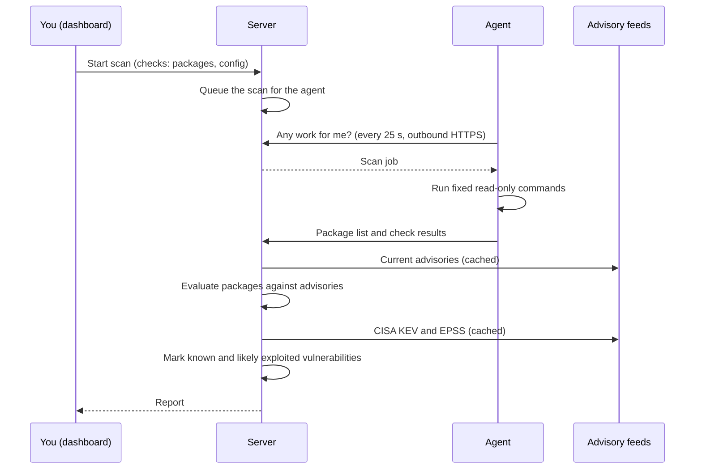

import ThemedImage from '@theme/ThemedImage';

## The rule

**The server never scans anything itself.** Every machine, the server's own included, is scanned by its own agent, as root. The server, which faces the network, runs without root and only stores results and checks them against the advisories.

  <ThemedImage
    alt="The server runs without root and serves the dashboard. Every machine, the server's own included, runs an agent as root that asks the server for work and sends back results. The server downloads the distributions' advisories."
    sources={{ light: '/img/architecture-light.svg', dark: '/img/architecture-dark.svg' }}
  />

## Who runs as what

| Component | Runs as | Listens on | Reaches |
| --- | --- | --- | --- |
| `deaconguard-server` | the `deaconguard` user, **no root**; systemd's `NoNewPrivileges` keeps it from ever gaining root, even through sudo | `0.0.0.0:8443` (HTTPS), and optionally an [agent-only port](./security/securing-the-dashboard.md#give-agents-their-own-port) | the distributions' advisory feeds, CISA KEV and EPSS |
| `deaconguard-agent` | **root**, so every check sees other users' processes, protected files and firewall rules | nothing | only its server, over HTTPS |

Why split them: the server is the part an attacker on your network can reach, so it holds no root. The parts with root, the agents, accept no connections at all; they ask their server for work. The [install script](./installation/install-script.md) gives the server's own machine an agent too, enrolled over `127.0.0.1`, and the dashboard marks that host **This server**.

In a container, the same split holds: the server's image runs as a non-root user with no capabilities, and an agent in a container, such as one pod of a [Kubernetes DaemonSet](./installation/kubernetes.md), runs as root with only the capabilities its checks need. It mounts its host's root filesystem read-only and runs each check chrooted there, with the host's own tools, so it reports on the host, not the container.

You can leave the server's machine without an agent (`--no-agent`). It is then not scanned as root: adding it on the Hosts page has the server scan it without root, and its results show partial coverage.

## Components

One binary, `deaconguard`, provides every role:

| Role | Service | Listens on | Data |
| --- | --- | --- | --- |
| Server | `deaconguard-server` | `0.0.0.0:8443` (HTTPS) | `/var/lib/deaconguard/` |
| Agent | `deaconguard-agent` | nothing | `/etc/deaconguard/agent.json` |
| Local mode | `deaconguard serve` | `127.0.0.1:7480` (HTTP) | `~/.local/share/deaconguard/` |

## How a scan works

The agent never evaluates vulnerabilities itself. It sends the package list, and the server decides which packages are vulnerable. A modified agent could report false check results, but it can't supply its own vulnerability verdicts.

## Enrollment

1. An admin creates a token, one-time or [reusable](./usage/agents.md#reusable-tokens). The token contains the server's URL, the SHA-256 fingerprint of its certificate's public key, and a random secret.
2. The agent connects to that URL, accepts only a certificate with that fingerprint, and presents the secret.
3. The server checks the secret (it stores only its hash), marks a one-time token used or counts a use of a reusable one, and gives the agent its own credential.
4. From then on the agent authenticates with that credential. Removing the host revokes it at once.

## Certificate pinning

An agent accepts the server's certificate in one of two ways:

1. **Its public key matches the fingerprint** from the enrollment token. This is how a self-signed certificate works safely: no certificate authority is involved, and a certificate re-issued for the same key keeps working.
2. **The agent machine's trusted certificate authorities vouch for it** for the server's name, as a browser would. This lets you move the server to your own certificate, for example from your company CA or Let's Encrypt, without enrolling every agent again.

Anything else is refused, and the agent reports that the server's certificate doesn't match the one it enrolled with.

Because of the second rule, someone who could obtain a certificate for your server's name from a CA the agents trust could impersonate the server. In practice that means controlling the server's DNS name. If your server uses a public DNS name, protect that domain, for example with a [CAA record](https://letsencrypt.org/docs/caa/) and registrar lock.

## What is stored

- **Roles:** the server checks each request against the account's [role](./usage/accounts.md#roles); the dashboard only hides what a role can't use.
- **Passwords:** PBKDF2 hashes.
- **Two-step sign-in:** authenticator keys in the database, as checking codes requires; recovery codes as SHA-256 hashes.
- **Tokens and agent credentials:** SHA-256 hashes on the server; the agent's own credential lives in `/etc/deaconguard/agent.json`, readable by root only.
- **Sudo passwords:** in memory for one scan only, never written or logged.
- **Scan logs:** steps, commands and timings, never command output or credentials.
